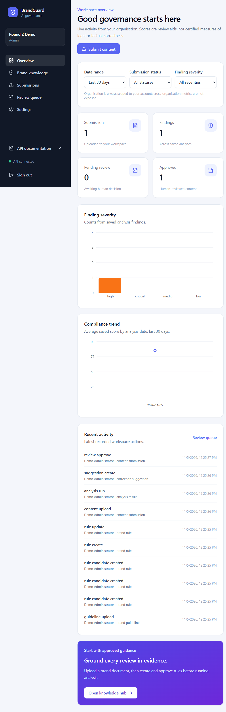
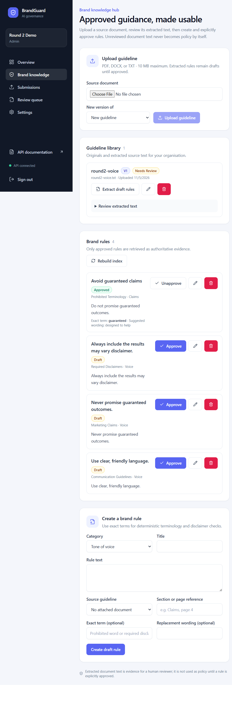
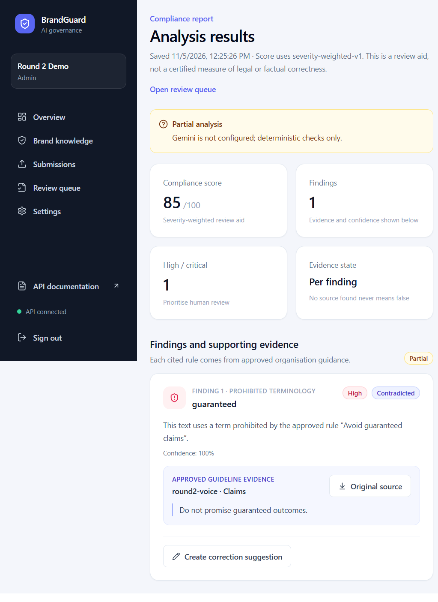

# BrandGuard AI — Round 2 Project Report

**Assessment date:** 2026-11-05  
**Project location:** `C:\CodeNexus`  
**Readiness:** Functional local MVP; **not production-deployment verified**.

## 1. Introduction

BrandGuard AI is a brand-governance application for organisations that need to review marketing copy against their approved brand rules. The application stores each organisation's guidelines, submissions, findings, correction decisions, and reviewer history in a tenant-scoped workspace.

## 2. Problem statement and solution

Brand policies are often long documents that are hard to apply consistently during content creation. BrandGuard extracts source documents, proposes candidate rules for a human to review, retrieves only approved rules as analysis evidence, and guides a reviewer through corrections and final approval. It does not publish content or claim to certify legal/factual correctness.

## 3. Round 2 feature-by-feature status

| Module | Status | Verified implementation and remaining caveat |
|---|---|---|
| Authentication and organisation management | Implemented | Registration creates an organisation and admin; login uses JWT and Argon2; admin creates team members; roles gate management/review routes; tenant separation is covered by tests. Logout clears the client session. User edit/deactivation, invitations, email verification, and password reset are not implemented. |
| Brand knowledge hub | Implemented | PDF, DOCX, and TXT guideline upload and extraction; version links; manually authored rules; source-text candidate extraction; candidates remain pending until an admin/brand manager approves them. Candidate extraction uses simple directive cues, not generative AI. |
| Content submission | Implemented | PDF, DOCX, and TXT extraction; original file is retained; extracted text preview, submission state, and organisation association are provided. OCR and structured marketing metadata (such as CTA/claim tagging) are not implemented. |
| RAG and retrieval | Implemented with provider limitation | ChromaDB indexes approved rules only, with organisation-specific collections and metadata. Retrieval failures produce partial-analysis notes. The only configured embedding implementation is Chroma's local `all-MiniLM-L6-v2`; provider switching is not implemented. |
| Hybrid compliance analysis | Implemented with AI limitation | Deterministic prohibited-term/disclaimer checks run locally; optional Gemini structured findings are checked against submitted text and retrieved rule IDs. Gemini was not tested because no API key was configured. External factual claim verification is not implemented. |
| Compliance report | Implemented | Actual saved findings, evidence, analysis status, score, severity, confidence, corrections, and timestamp are shown. Score uses `severity-weighted-v1`: Critical 25, High 15, Medium 8, Low 3 points deducted from 100, floor 0. This is a review heuristic, not accuracy or legal certification. |
| Correction suggestions | Implemented | Suggestions can be created, accepted, rejected, or edited. Suggested wording and decisions are stored separately; original submission text remains unchanged. Gemini-based suggestions are optional. |
| Human review | Implemented | Reviewer, decision, comment, timestamp, prior status, and resulting status are persisted. Reject/revision requires a comment. Human approval remains final; publishing is not automated. |
| Dashboard and analytics | Implemented | Counts, severity distribution, compliance trends, and recent activity come from persisted data. Date-range, review-status, and finding-severity filters are available. Organisation is fixed to the authenticated tenant rather than offering cross-tenant filtering. |
| Security and data protection | Core controls implemented | Password hashing, JWT, role checks, organisation-scoped API access, upload validation/size limits, protected environment configuration, CORS allowlist, and audit events are present. Rate limiting, email lifecycle features, and a configured production gateway remain deployment responsibilities. |

## 4. Architecture and technology

```text
React + Vite + Tailwind + React Router
              │ Axios (/api proxy or configured API origin)
              ▼
FastAPI routers ── Pydantic schemas ── SQLAlchemy services
      │                    │
      │                    ├── PostgreSQL (deployment) / SQLite (local)
      │                    └── Alembic migrations
      ├── document extraction (PyMuPDF, python-docx, UTF-8 TXT)
      ├── ChromaDB per-organisation approved-rule collections
      └── optional Gemini structured analysis and suggestions
```

The frontend uses React 18, Vite, Tailwind CSS, React Router, Axios, Lucide, and Recharts. The backend uses FastAPI, Pydantic, SQLAlchemy, Alembic, PyMuPDF, python-docx, ChromaDB, and the Google GenAI SDK.

## 5. Data model and AI/RAG flow

Principal database records include `Organization`, `User`, `BrandGuideline`, `BrandRule`, `ContentSubmission`, `AnalysisResult`, `Violation`, `CorrectionSuggestion`, `ApprovalHistory`, `AuditLog`, and `BrandAsset`. Tenant-owned business records carry an organisation ID. Guideline version records link to the prior version while keeping rules tied to their source document. The latest migration also captures review status transitions.

The analysis sequence is: extract text → identify draft source rules → human approval → index approved rules → retrieve within the tenant → run deterministic checks and optional Gemini → validate finding text/evidence IDs → persist report and score → suggest/edit corrections → human review and audit. Missing Gemini or retrieval support is reported as partial analysis, not a successful full analysis.

## 6. Local installation and operation

Requirements: Python 3.11+, Node.js 20+, and optionally Docker/PostgreSQL for local database testing.

1. Copy `.env.example` to `.env` and configure a strong random `JWT_SECRET_KEY`. Set `DATABASE_URL` for PostgreSQL if needed; `GEMINI_API_KEY` is optional.
2. In `backend`, create/activate a virtual environment and run `python -m pip install -r requirements.txt`.
3. Apply migrations with `alembic upgrade head`, then start `uvicorn app.main:app --reload --port 8000`.
4. In `frontend`, run `npm install` and `npm run dev`.
5. Visit `http://localhost:5173`, register an admin, upload a guideline, extract/edit candidates, approve rules, upload content, analyse, and review.
6. API documentation is served at `http://localhost:8000/docs`.

The Vite development proxy targets `http://localhost:8000` by default. `VITE_API_PROXY_TARGET` changes that target; deployed frontends use `VITE_API_BASE_URL`.

## 7. Deployment configuration and verification

Deployment scaffolding exists in `render.yaml`, `backend/Dockerfile`, `docker-compose.yml`, and `frontend/vercel.json`. Render is configured for PostgreSQL, persistent upload/Chroma storage, production environment validation, and a health endpoint. Vercel serves the SPA and accepts the API base URL.

**Not verified:** no hosted PostgreSQL service, Render deployment, Vercel deployment, or configured Gemini key was available for this run. No deployment URL is claimed. Before public launch, configure production secrets/origins, verify database migration/backup and persistent storage, set gateway rate limits, test provider calls, and run a deployed end-to-end workflow.

## 8. Verification evidence

The local API was exercised end to end using a real demo organisation: TXT guideline upload, three source-derived pending candidates, explicit rule approval, content upload, evidence-linked partial analysis, correction suggestion, and human approval (`pending → approved`). The original submission was not altered.

Automated checks run after the Round 2 changes:

- `pytest -q`: **19 passed**, one upstream Starlette/AnyIO deprecation warning.
- `npm run build`: succeeded.
- `npm audit`: **0 vulnerabilities**.
- `python -m compileall -q backend\app backend\alembic`: succeeded.
- `alembic upgrade head` and `alembic check`: succeeded; no schema drift.
- `.gitignore` checked: `.env`, uploads, Chroma data, database files, and `node_modules` are ignored.

The screenshots below are actual captures of the locally running frontend backed by the local API. Demo data is stored in ignored local data directories, not tracked source files.

### Dashboard



### Brand knowledge hub



### Evidence-linked compliance report



## 9. Remaining manual actions and limitations

- Add a real `GEMINI_API_KEY`, then verify model availability, structured analysis, failure handling, and correction generation.
- Provision PostgreSQL and exercise migrations, tenant isolation, backups, and recovery against it.
- Deploy to Render/Vercel and verify production CORS, API URL, persistent files/vectors, health checks, and the entire user journey.
- Prepare/publish a public Git repository; this workspace currently has no Git repository configured.
- Add rate limiting before public exposure. OCR, external fact sources, user lifecycle management, and a pluggable embedding provider remain future work.

## 10. Round 3 proposals

1. **Advanced Visual Brand Compliance Engine:** Logo comparison, image analysis, OCR, brand colour and typography verification.
2. **Evidence-Based Claim Verification:** Source intelligence, claim contradiction detection, evidence freshness and verification.
3. **Advanced Brand Governance and Analytics:** Violation trends, governance reports, recurring issue detection and approval analytics.

These are proposals only and are not implemented in the Round 2 build.
